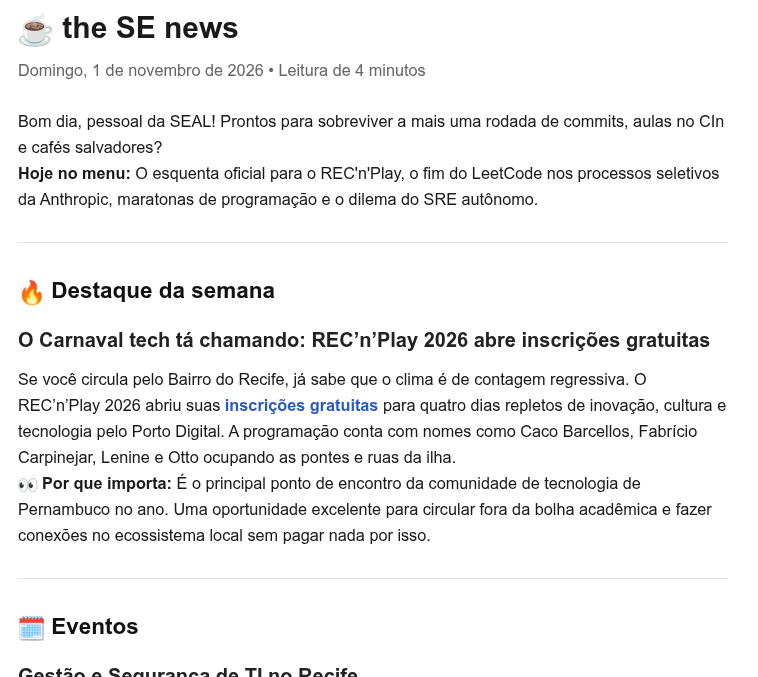
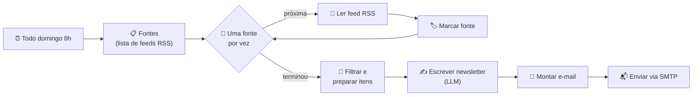

# ☕ the SE news

Newsletter semanal automática de **Engenharia de Software**, idealizada para a **SEAL – Liga Acadêmica de Engenharia de Software do CIn-UFPE**.

Todo domingo de manhã, um workflow no [n8n](https://n8n.io) coleta notícias de várias fontes, filtra o que é novo e relevante, pede para uma IA escrever a edição no estilo do [the news](https://thenews.com.br) e envia por e-mail. O foco é em três temas:

- 🗓️ **Eventos** de tecnologia e ES (prioridade para Recife/PE)
- 🏆 **Hackathons** e competições
- 🌶️ **Temas polêmicos** da área, com uma pergunta para discutir na liga

<p align="center">
  
</p>

---

## Como funciona



1. **Coleta:** o loop lê cada feed RSS da lista. Se um feed falhar, o workflow segue em frente e a fonte com problema aparece num aviso no rodapé do e-mail.
2. **Limpeza:** descarta itens com mais de 7 dias, remove duplicados, limita a quantidade por fonte (para nenhuma dominar a edição), desembrulha links do Google Alertas e lembra o que já foi enviado nas semanas anteriores.
3. **Escrita:** um LLM recebe os itens e monta a edição com seções fixas (Destaque, Eventos, Hackathons, Treta da semana, Vale a leitura, Agenda). O prompt proíbe inventar datas, locais ou prazos que não estejam nos itens.
4. **Envio:** o HTML gerado vai por e-mail via SMTP.

### Fontes padrão

| Foco | Fontes |
|---|---|
| Eventos | Google News: eventos tech em Recife/PE, Porto Digital, eventos de ES |
| Hackathons | Google News: hackathons em PE/Nordeste, inscrições abertas, maratonas de programação |
| Temas polêmicos | Google News (IA e devs), Hacker News (posts com 100+ pontos), Lobsters, The Pragmatic Engineer, r/ExperiencedDevs |

Você pode adicionar **Google Alertas** como feed RSS (veja [Personalizar](#personalizar)).

---

## Stack

- **[n8n](https://n8n.io)** (self-hosted, Community Edition) para orquestrar o fluxo
- **Docker / Docker Compose** para rodar o n8n localmente
- **Google Gemini** (free tier) como LLM, trocável por Claude, OpenAI etc.
- **RSS** (Google News, hnrss, Lobsters, Substack, Reddit) como fonte de dados
- **SMTP** (Gmail com senha de app) para envio

---

## Como rodar

### Pré-requisitos

- Docker e Docker Compose
- Uma conta Google (para a chave do Gemini e para enviar e-mail)

No Ubuntu:

```bash
sudo apt update
sudo apt install -y docker.io docker-compose-v2
sudo usermod -aG docker $USER   # depois, saia e entre na sessão de novo
```

### 1. Subir o n8n

```bash
git clone https://github.com/AmandaTrinity/the_news_SE.git
cd the_news_SE
docker compose up -d
```

Na primeira vez a imagem é baixada e o n8n leva alguns segundos para iniciar. Acompanhe com `docker compose logs -f n8n`.

Abra **http://localhost:5678** (ou `http://127.0.0.1:5678`) e crie a conta de dono. Essa conta é **só local**, não é cadastro no site do n8n.

### 2. Importar o workflow

```bash
docker compose exec n8n n8n import:workflow --input=/files/the-se-news-v2.json
```

Atualize a página e abra o workflow **"the SE news (SEAL) v2"**.

### 3. Credencial do LLM (Gemini)

1. Gere uma chave gratuita em [Google AI Studio](https://aistudio.google.com) → *Get API key*.
2. No nó **Modelo de IA**, crie uma credencial nova e cole a chave.
3. Em **Model**, escolha um modelo *Flash* **pela lista** (o dropdown só mostra modelos disponíveis para a sua chave).

> Se aparecer erro 404 de modelo indisponível, é porque o Google aposentou aquela versão: escolha outra na lista. Se aparecer erro 429 (cota), tente uma variante *flash-lite*.

### 4. Credencial de e-mail (SMTP)

1. Na sua conta Google, ative a **verificação em duas etapas**.
2. Em [myaccount.google.com](https://myaccount.google.com), busque **Senhas de app** e crie uma (ex.: "n8n").
3. No nó **Enviar e-mail**, crie uma credencial SMTP:
   - **User:** seu Gmail
   - **Password:** a senha de app de 16 letras (não a senha normal)
   - **Host:** `smtp.gmail.com`
   - **Port:** `465`
   - **SSL/TLS:** ligado
4. Troque `seu-email@gmail.com` pelos seus endereços em **From Email** e **To Email**.

### 5. Testar e ativar

- Clique em **Execute workflow** para rodar na hora e receber a edição.
- Quando estiver satisfeita(o), clique em **Publish** (ou ative o toggle *Active*) para rodar sozinho todo domingo às 8h.

> O agendamento só dispara se o n8n estiver rodando nesse horário. Com `restart: unless-stopped`, ele sobe junto com o Docker sempre que o computador liga.

---

## Personalizar

### Fontes

Tudo fica no nó **Fontes (edite aqui)**. Para buscas no Google News, basta adicionar uma linha:

```js
{ nome: 'GNews: CIn UFPE', url: gnews('"CIn UFPE" OR "Centro de Informática" when:7d') },
```

O `when:7d` restringe aos últimos 7 dias.

Para usar **Google Alertas**: crie o alerta em [google.com/alerts](https://www.google.com/alerts), clique em *Mostrar opções*, escolha **Enviar para: Feed RSS**, copie o link do ícone RSS e adicione à lista:

```js
{ nome: 'Alerta: hackathon Recife', url: 'https://www.google.com/alerts/feeds/XXXX/YYYY' },
```

### Filtro

No topo do nó **Filtrar e preparar itens**:

```js
const DIAS = 7;            // janela de tempo
const MAX_POR_FONTE = 12;  // máximo de itens por fonte
const MAX_TOTAL = 70;      // máximo de itens enviados ao LLM
```

### Estilo e seções

O prompt fica no nó **Escrever newsletter** (mensagem de sistema). Lá estão o tom, o foco, as seções e as regras de precisão.

### Horário

No nó **Todo domingo 8h**, a expressão cron `0 8 * * 0` significa minuto 0, hora 8, domingo. O fuso é `America/Recife`, definido no `docker-compose.yml` e nas configurações do workflow.

### Trocar o LLM

Apague o nó **Modelo de IA** e conecte outro modelo de chat (Anthropic, OpenAI, Ollama...) na entrada *Model* do nó **Escrever newsletter**.

---

## Estrutura do repositório

```
the_news_SE/
├── docker-compose.yml           # n8n com volume persistente e fuso de Recife
├── workflows/
│   └── the-se-news-v2.json      # workflow para importar no n8n
├── docs/
│   └── exemplo-edicao.png       # print de uma edição gerada
└── README.md
```

---

## Segurança e privacidade

- **Credenciais não ficam no repositório.** A chave do Gemini e a senha de app ficam guardadas dentro do n8n, no volume Docker `n8n_data`.
- **Cuidado ao exportar workflows.** Um JSON exportado do n8n não leva as credenciais, mas leva os campos preenchidos dos nós (como e-mails). Confira antes de fazer commit. Backups com o padrão `workflows/backup*.json` já estão no `.gitignore`.
- O n8n escuta apenas em `127.0.0.1`, então não fica acessível para outras pessoas na mesma rede.

---

## Comandos úteis

```bash
docker compose stop                 # parar
docker compose start                # iniciar
docker compose logs -f n8n          # ver logs
docker compose pull && docker compose up -d   # atualizar o n8n

# backup de todos os workflows (contém dados reais, não commitar!)
docker compose exec n8n n8n export:workflow --all --output=/files/backup.json
```

---

## Limitações conhecidas

- **A memória de itens já enviados só funciona com o workflow publicado/ativo.** Em execuções manuais de teste, os mesmos itens podem se repetir.
- **O Reddit às vezes bloqueia requisições de servidores.** Se a fonte aparecer sempre no aviso de falhas, remova-a da lista.
- **A qualidade da edição depende mais das fontes do que do prompt.** Vale revisar nas primeiras semanas quais fontes trazem conteúdo bom e quais só trazem ruído.
